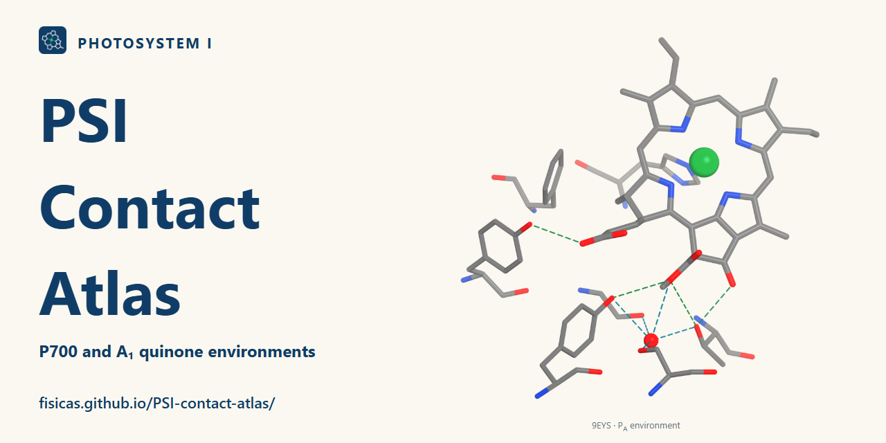

<p></p>

# PSI Contact Atlas

**Cite v1.1.0** · [DOI 10.5281/zenodo.24406867](https://doi.org/10.5281/zenodo.24406867)

<p><a href="https://fisicas.github.io/PSI-contact-atlas/"></a></p>

**Published release · 1.1.0.** Release date 2026-11-20. See the [versioned GitHub release](https://github.com/Fisicas/PSI-contact-atlas/releases/tag/v1.1.0) for citation and archive details.

## What changed since v1.0.0

- **Eight added structures:** 9SE6, 9LUT, 8WEY, 7DKZ, 9UH3, 9HYU, 9KZ9 and 8XLS. Coverage expands from **14 to 22 structures, 32 to 40 protomers and 128 to 160 scenes**.
- **New optional density views:** unmasked sections and clickable mesh previews open interactive native-atom/density views for 39 protomers (156 scenes), with static PNG fallbacks and explicit 1JB0 unavailability. Density options start closed; the original molecule/label view remains the default.
- **New source and scientific checks:** new-entry mappings/preparation provenance, all-entry cofactor-geometry checks and a scoped local-density feature screen, with downloadable diagnostic samples and retained source-model qualifications.
- **Presentation and reliability:** concise notices/collapsed provenance, exact local downloads, navigation/export fixes, a wrapping four-GIF README gallery and the selected icon/social artwork.

[Full release notes and added-structure table](docs/RELEASE_NOTES_1.1.0.md) · [Scientific/comparison scope](docs/COMPARISON_SCOPE.md). Mesh previews now open the exact scene and contour in the [interactive density viewer](docs/INTERACTIVE_DENSITY.md); static images remain available.

Interactive deposited heavy-atom environments around the photosystem I special pair (P700 or its source-specific counterpart), P<sub>A</sub>, and A₁ quinones. Rotate scenes, compare homologous atom pairs, inspect optional local-density figures and download coordinate crops, CSVs and PyMOL scripts.

| Coverage | Version 1.1.0 release |
|---|---:|
| Structures | 22 |
| Deposited protomers | 40 |
| Scenes | 160 |
| Scene contact rows | 1,107 |
| Unique atom pairs | 882 |
| Numeric homologous comparison values | 1,617 |
| Comparison cells, including blanks | 1,720 |
| Interactive density scenes | 156 |
| Protomers with experimental-density figures | 39 |
| Scenes with experimental-density figures | 156 |

Open `index.html` locally or serve this directory. The molecular view and original label layout remain the default. Optional unmasked sections and mesh previews start closed and load on demand. All 208 mesh thumbnails open an interactive density view with rotation, Hand / pan, contour controls and candidate-first atom inspection; direct Static PNG links remain available. Interactive maps load only on the separate density page. 1JB0 retains coordinate views with explicit unavailable-experimental-data messaging. There are 254 section and 208 mesh images; figures are display aids, not automatic model validation.

## Molecular previews

Four examples from the atlas. Each animation appears on its own line so the molecules and captions fit the reading column, including on narrow screens. Select a molecule to open its interactive scene.

<p><a href="https://fisicas.github.io/PSI-contact-atlas/#/view/1JB0_prot1_P_A"></a></p>

**1JB0 · P<sub>A</sub> network** — *S. elongatus*, X-ray 2.5 Å. [Open scene](https://fisicas.github.io/PSI-contact-atlas/#/view/1JB0_prot1_P_A).

<p><a href="https://fisicas.github.io/PSI-contact-atlas/#/view/7COY_prot1_special_pair"></a></p>

**7COY · special pair** — *A. marina*, Chl *d* / P740, cryo-EM 2.5 Å. [Open scene](https://fisicas.github.io/PSI-contact-atlas/#/view/7COY_prot1_special_pair).

<p><a href="https://fisicas.github.io/PSI-contact-atlas/#/view/9YL7_prot1_A1A"></a></p>

**9YL7 · A<sub>1A</sub>** — PQ-9 (30 of 55 heavy atoms deposited), cryo-EM 1.68 Å. [Open scene](https://fisicas.github.io/PSI-contact-atlas/#/view/9YL7_prot1_A1A).

<p><a href="https://fisicas.github.io/PSI-contact-atlas/#/view/9AU4_prot1_A1B"></a></p>

**9AU4 · A<sub>1B</sub>** — DMPBQ in the MenB variant, cryo-EM 2.03 Å. [Open scene](https://fisicas.github.io/PSI-contact-atlas/#/view/9AU4_prot1_A1B).

Each loop is drawn by the atlas viewer from deposited heavy atoms: gray C, blue N, red O, green Mg and yellow S; thicker sticks mark the cofactor. Dashed guides show measured separations in Å: dark polar candidates, teal water contacts, green Mg–ligand contacts, mauve two-acceptor O···O contacts and gray longer context. A short separation is not proof of a hydrogen bond. The animations are illustrative baseline scenes; use the interactive atlas and source-specific qualifications for the current 22-structure / 40-protomer comparison.

## Scientific interpretation

Every measurement is a Euclidean separation between named atoms in the archived deposited model, in Å. Two decimal places are display precision, not a distance uncertainty. Hydrogen positions, donor angles, protonation, occupancy and redox state are not established by these measurements.

Source-specific qualifications are integral to this dataset. In particular, 1JB0/7DKZ/9KZ9 quinone chemical geometry, the 9KZ9 axial Mg separation, weak site waters in 7DKZ/9S6P/9SK3, local oxygen features in 7COY, long 5OY0 protomer 3 axial distances and the 9AU4 contour exception remain explicit. Positive density does not clear intraligand chemistry. [Scientific review](docs/SCIENTIFIC_REVIEW.md) · [Per-cofactor context](downloads/validation/cofactor_geometry.csv) · [Methods](docs/METHODS.md).

The eight additions received an extra diagnostic N/O-neighborhood supplement; the 14 baseline scene selections were retained. Pair counts are not exhaustive cross-species inventories. Deposited protomers and related reconstructions are not independent biological replicates. [Comparison scope](docs/COMPARISON_SCOPE.md). The structural census remains a separate project.

## Sources and provenance

Archived PDB coordinates and CCD definitions are included under `build/inputs`, with source hashes/revisions. Current-coordinate rechecks found identical identity/XYZ/occupancy/B records for all 22 entries (1,152,290 atoms). Current source-validation snapshots and source-bound review context are packaged separately from the atomic inputs. Neither current metadata revisions nor branding caused coordinate replacement.

The eight additions are 9SE6, 9LUT, 8WEY, 7DKZ, 9UH3, 9HYU, 9KZ9 and 8XLS. Preparation, split-chain, source-model ancestry and unresolved-condition notes are retained. 9OY9/9OZ3 cite the linked bioRxiv preprint; their monomer/trimer description follows the primary study while documenting the deposited title discrepancy.

## Rebuild and verify

Use Python 3.12 with the pinned `build/requirements.txt`; citation checks also use `build/requirements-metadata.txt`. Install dependencies into an appropriate project environment rather than upgrading an established shared environment.

```text
python tools/build_atlas.py
python tools/write_docs.py
python tools/verify_public.py
python tools/verify_review_context.py
python tools/verify_scientific_closure.py
python tools/verify_release_metadata.py
python tools/verify_density_views.py
python tools/verify_interactive_density.py
python tools/verify_download_payloads.py
python tools/verify_branding.py
python tools/verify_readme_counts.py
python -m unittest discover -s tests -v
node tests/test_density_options_all.cjs . /path/outside/repository/report.json
```

The coordinate build is offline from packaged inputs. Full density regeneration additionally requires the hash-checked external map cache and the specified scientific/PyMOL environments; multi-GB raw maps are not part of the website. [Build instructions](build/README.md) · [Density methods](docs/DENSITY_VISUALIZATION_PILOT.md) · [Validation receipts and limits](docs/VALIDATION.md) · [Release candidate review](docs/RELEASE_CANDIDATE.md) · [Browser review](docs/BROWSER_REVIEW.md).

## Citation, licensing and release status

Release date 2026-11-20. See the [versioned GitHub release](https://github.com/Fisicas/PSI-contact-atlas/releases/tag/v1.1.0) for citation and archive details. Citation metadata are synchronized in `CITATION.cff`, `.zenodo.json`, `CITATION.bib`, `CITATION.ris` and `CITATION.csl.json`. Cite the individual PDB entries and primary papers as well. [Citation scope and DOI handling](docs/CITATION.md).

Code: [MIT](LICENSE). Data/figures/documentation: [CC BY 4.0](LICENSE-DATA.md). Unmodified wwPDB source files retain their source terms. [Published website](https://fisicas.github.io/PSI-contact-atlas/) · [Repository](https://github.com/Fisicas/PSI-contact-atlas).
