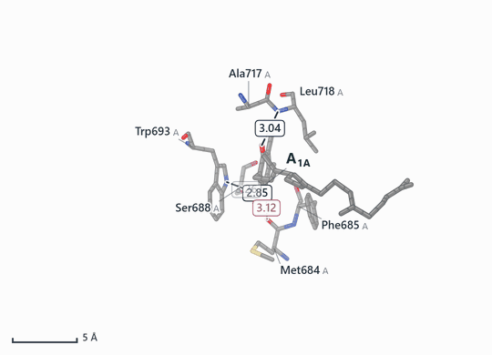
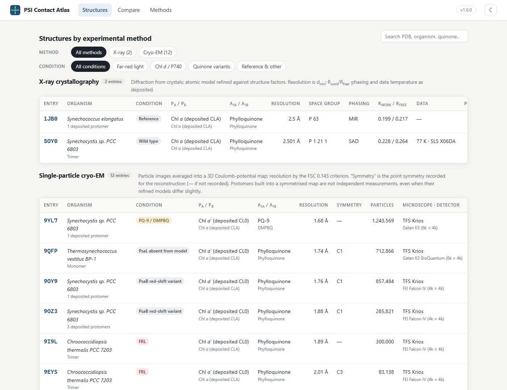
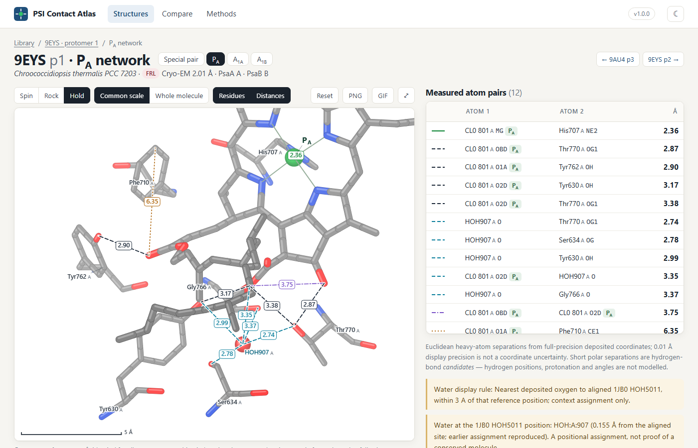
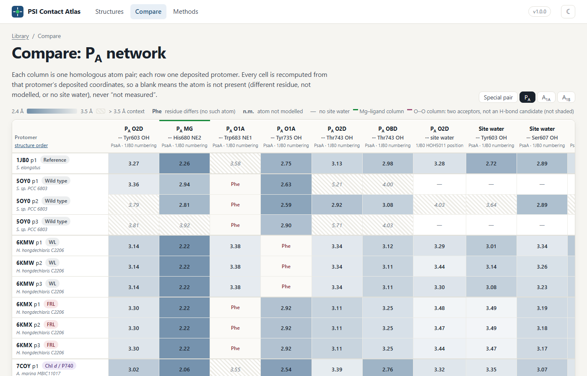
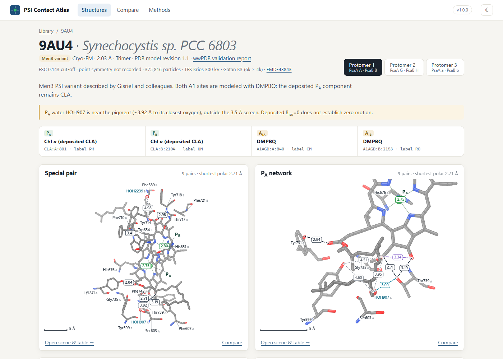
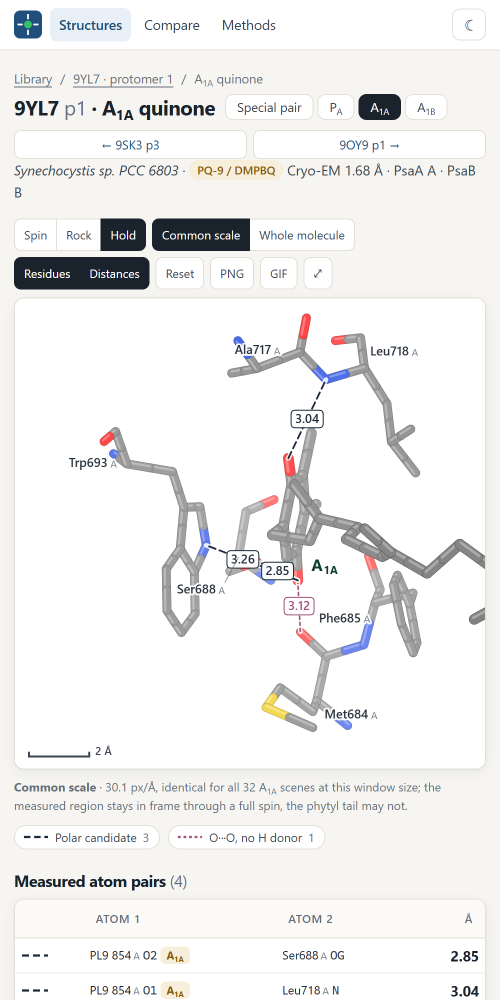

# PSI Contact Atlas

**Heavy-atom separations around the photosystem I special pair, the P<sub>A</sub> chlorophyll network and both A<sub>1</sub> quinone sites, computed from 14 deposited PDB entries (32 protomers, 128 scenes, 691 unique atom pairs).**

Open the interactive atlas: **[https://fisicas.github.io/PSI-contact-atlas/](https://fisicas.github.io/PSI-contact-atlas/)** · or download this repository and open `index.html` in any modern browser (no server, no install, works offline).

> Version 1.0.0 (2026-11-17). A curated comparative atlas of selected PSI donor and A<sub>1</sub>-site environments, not a systematic census of all PSI structures or a measurement of electron-transfer properties. Values are computed from deposited coordinates and checked independently; the atlas has not been peer reviewed. Please read [What it can and cannot tell you](#what-it-can-and-cannot-tell-you) before using a number.

<table>
<tr>
<td align="center"><br><sub><b>1JB0 · P<sub>A</sub> network</b> — <i>S. elongatus</i>, X-ray 2.5 Å</sub></td>
<td align="center"><br><sub><b>7COY · special pair</b> — <i>A. marina</i> Chl <i>d</i> / P740, cryo-EM 2.5 Å</sub></td>
</tr>
<tr>
<td align="center"><br><sub><b>9YL7 · A<sub>1A</sub></b> — PQ-9 (30 of 55 heavy atoms deposited), cryo-EM 1.68 Å</sub></td>
<td align="center"><br><sub><b>9AU4 · A<sub>1B</sub></b> — DMPBQ in the MenB variant, cryo-EM 2.03 Å</sub></td>
</tr>
</table>

<sub>Each loop is drawn by the atlas’s own viewer from deposited heavy atoms: grey C, blue N, red O, green Mg, yellow S; thicker sticks are the cofactor. Dashed lines are measured separations in Å (dark: polar candidate ≤ 3.5 Å; teal: water-involved; green: Mg–ligand; mauve: two oxygen acceptors, not a hydrogen-bond candidate; grey dotted: longer context). The interactive site re-places labels to avoid overlaps.</sub>

## Why these four environments

In PSI, light drives charge separation from the special pair (P700, or P740 in the chlorophyll *d* entries; chlorophylls P<sub>A</sub> and P<sub>B</sub>) along two nearly symmetric cofactor branches, through the A<sub>1</sub> quinones to the iron–sulfur clusters. Two structural features make these sites worth comparing atom by atom:

- **P<sub>A</sub> has a hydrogen-bond network that P<sub>B</sub> lacks.** In the 1JB0 reference, P<sub>A</sub> (a Chl *a*′ epimer) sits in a polar network of PsaA Thr743, Tyr603, Ser607, Gly739 and a water, which P<sub>B</sub> lacks ([Jordan et al. 2001](https://doi.org/10.1038/35082000)). The network is a recurring candidate for tuning the special pair’s electronic asymmetry, so its geometry in far-red-light (FRL) PSI, chlorophyll *d* PSI and engineered variants is of direct interest.
- **Each A<sub>1</sub> quinone has one carbonyl near a backbone N–H** (PsaA Leu722 / PsaB Leu706 in 1JB0) and the other near a Trp NE1, a Ser OG and the Phe689 backbone N–H (1JB0 PsaA numbering). That second carbonyl also sits about 3 Å from the Met688 backbone C=O oxygen; two acceptors cannot hydrogen-bond each other, so the atlas lists that pair separately as “O···O, no H donor”. Replacing phylloquinone (the MenB variant with DMPBQ; the PQ-9/DMPBQ entry 9YL7) changes the ring and its substituents while the pocket stays largely conserved.

## What you can do with it



- **Browse by experimental method.** X-ray and single-particle cryo-EM entries are grouped separately, with the technique fields read from each deposit, a link to each entry’s wwPDB validation report, and filters by growth condition.
- **Rotate a scene and read it.** Drag to rotate, Ctrl + wheel to zoom. Hovering a dashed guide highlights its row in the atom-pair table; each row opens to show the class, the chemical basis and its stable contact ID. PNG and GIF export from any orientation.



- **Compare one contact across all 32 protomers.** Each column is a homologous atom pair (partner residues mapped to 1JB0 numbering by sequence alignment); each cell is computed from that protomer’s coordinates. A blank cell says *why*: the residue differs, the atom is not modelled, or no deposited water meets the site rule.



- **See each structure’s cofactor identities and lineage**, with the deposited component name beside the interpreted pigment (a deposited CLA at P<sub>A</sub> is not silently renamed Chl *a*′) and case-sensitive chain IDs.

<table><tr>
<td width="62%"></td>
<td></td>
</tr></table>

- **Download and cite tables** with stable IDs: one row per physical atom pair, one table per environment, per-scene tables, mmCIF crops and PyMOL scripts. Every column is explained in [`downloads/README.md`](downloads/README.md).

## Observations the compare view makes visible

These are statements about the deposited models, not functional conclusions:

- **Residue differences at network positions.** Several entries carry Phe where 1JB0 has Trp683 (5OY0, 6KMX, 9AU4, 9EYS, 9I9L, 9YL7, 9OY9, 9OZ3), and white-light 6KMW carries Phe where 1JB0 has Tyr735 while far-red-light 6KMX keeps the Tyr. The Chl *d* entries have Ser where 1JB0 has Thr743.
- **Protomers are not replicates.** Within an entry, values can be nearly identical or differ by up to 0.35 Å (more in the X-ray 5OY0 trimer), depending on how symmetry was imposed on the map and model. Neither case is an independent repeat measurement.
- **Unusual separations stay visible.** 5OY0 protomer 3 has long P<sub>A</sub> Mg–His separations; 9AU4 HOH907 sits 3.95 Å from P<sub>A</sub> O2D, outside the 3.5 Å polar screen; 9AU4 Trp693 NE1 is listed as unobserved in its deposition.

## What it can and cannot tell you

| It can | It cannot |
|---|---|
| Give the Euclidean separation between two deposited heavy atoms, from full-precision coordinates, with native chain/residue/atom names. | Confirm a hydrogen bond. Short polar heavy-atom separations are geometric observations; only chemically compatible donor–acceptor pairs are potential hydrogen-bond contacts, and hydrogen positions, protonation states and angles are not established here. |
| Say what the atom types allow (the `chemical_basis` column: donor–acceptor compatible, acceptor–acceptor, water-involved, unresolved). | Give the uncertainty of a distance. Five decimals are computational precision and 0.01 Å is display precision; nominal resolution is not a per-atom error, and local map quality is not summarised (each entry links its wwPDB validation report). |
| Compare a homologous contact across 32 protomers and show where the residue itself differs. | Treat protomers as independent replicates, or count a pair shown in two scenes twice (865 scene rows are 691 unique pairs). |
| Separate deposited component identity, interpreted pigment name, functional role and chain ID. | Prove a water is conserved or absent (“no deposited water meets the site rule” is not “water absent”), establish Mg coordination geometry or stereochemistry, or establish model ancestry. |

## Structures

| PDB | Organism | Condition | Method | A<sub>1A</sub> / A<sub>1B</sub> | Protomers | Scenes | Paper |
|---|---|---|---|---|---|---|---|
| [1JB0](https://www.rcsb.org/structure/1JB0) | *Synechococcus elongatus* | Reference | X-ray 2.5 Å · P 63, MIR phasing | Phylloquinone / Phylloquinone | 1 | curated | [Jordan et al. 2001](https://doi.org/10.1038/35082000) |
| [5OY0](https://www.rcsb.org/structure/5OY0) | *Synechocystis sp. PCC 6803* | Wild type | X-ray 2.501 Å · P 1 21 1, SAD phasing | Phylloquinone / Phylloquinone | 3 | curated | [Malavath et al. 2018](https://doi.org/10.1016/j.bbabio.2018.02.002) |
| [9YL7](https://www.rcsb.org/structure/9YL7) | *Synechocystis sp. PCC 6803* | PQ-9 / DMPBQ | Cryo-EM 1.68 Å · symmetry not in mmCIF, EMD-73077 | PQ-9 / DMPBQ | 1 | curated | to be published |
| [9QFP](https://www.rcsb.org/structure/9QFP) | *Thermosynechococcus vestitus BP-1* | PsaL absent from model | Cryo-EM 1.74 Å · C1, EMD-53120 | Phylloquinone / Phylloquinone | 1 | curated | [Boyka et al. 2026](https://doi.org/10.1007/s11120-026-01237-x) |
| [9OY9](https://www.rcsb.org/structure/9OY9) | *Synechocystis sp. PCC 6803* | PsaB red-shift variant | Cryo-EM 1.76 Å · C1, EMD-71005 | Phylloquinone / Phylloquinone | 1 | derived by rule | to be published |
| [9OZ3](https://www.rcsb.org/structure/9OZ3) | *Synechocystis sp. PCC 6803* | PsaB red-shift variant | Cryo-EM 1.88 Å · C1, EMD-71048 | Phylloquinone / Phylloquinone | 3 | derived by rule | to be published |
| [9I9L](https://www.rcsb.org/structure/9I9L) | *Chroococcidiopsis thermalis PCC 7203* | FRL | Cryo-EM 1.89 Å · symmetry not in mmCIF, EMD-52762 | Phylloquinone / Phylloquinone | 3 | curated | [Consoli et al. 2025](https://doi.org/10.1126/science.ado6830) |
| [9EYS](https://www.rcsb.org/structure/9EYS) | *Chroococcidiopsis thermalis PCC 7203* | FRL | Cryo-EM 2.01 Å · C3, EMD-50063 | Phylloquinone / Phylloquinone | 3 | curated | [Consoli et al. 2025](https://doi.org/10.1126/science.ado6830) |
| [9AU4](https://www.rcsb.org/structure/9AU4) | *Synechocystis sp. PCC 6803* | MenB variant | Cryo-EM 2.03 Å · symmetry not in mmCIF, EMD-43843 | DMPBQ / DMPBQ | 3 | curated | [Gisriel et al. 2024](https://doi.org/10.1126/sciadv.adp4937) |
| [6KMW](https://www.rcsb.org/structure/6KMW) | *Halomicronema hongdechloris C2206* | WL | Cryo-EM 2.35 Å · C3, EMD-0726 | Phylloquinone / Phylloquinone | 3 | curated | [Kato et al. 2020](https://doi.org/10.1038/s41467-019-13898-5) |
| [6KMX](https://www.rcsb.org/structure/6KMX) | *Halomicronema hongdechloris C2206* | FRL | Cryo-EM 2.41 Å · C3, EMD-0727 | Phylloquinone / Phylloquinone | 3 | curated | [Kato et al. 2020](https://doi.org/10.1038/s41467-019-13898-5) |
| [9S6P](https://www.rcsb.org/structure/9S6P) | *Acaryochloris marina NIES-2412* | Chl d / P740 | Cryo-EM 2.44 Å · symmetry not in mmCIF, EMD-54627 | Phylloquinone / Phylloquinone | 1 | curated | [Oliver et al. 2026](https://doi.org/10.1126/sciadv.aed7355) |
| [7COY](https://www.rcsb.org/structure/7COY) | *Acaryochloris marina MBIC11017* | Chl d / P740 | Cryo-EM 2.5 Å · symmetry not in mmCIF, EMD-30420 | Phylloquinone / Phylloquinone | 3 | curated | [Hamaguchi et al. 2021](https://doi.org/10.1038/s41467-021-22502-8) |
| [9SK3](https://www.rcsb.org/structure/9SK3) | *Acaryochloris marina NIES-2412* | Chl d / P740 | Cryo-EM 2.63 Å · symmetry not in mmCIF, EMD-54956 | Phylloquinone / Phylloquinone | 3 | curated | [Oliver et al. 2026](https://doi.org/10.1126/sciadv.aed7355) |

**Scope and updates.** The first 12 entries were selected and their scenes curated and reviewed one by one. Cyanobacterial PSI entries released after that curated build are added with scenes derived by a documented rule (9OY9, 9OZ3 in this version); the rule and its check against curated scenes are in [`docs/METHODS.md`](docs/METHODS.md). Display alignment to 1JB0 is a camera convention, not model ancestry.

## Doing it yourself in PyMOL

Everything the site shows can be reproduced in [PyMOL](https://pymol.org/), either from the scene crops in this repository or from the full deposited entries.

### 1 · Open any scene with its script

Every scene has a script in [`downloads/pymol/`](downloads/pymol). From the repository root:

```bash
pymol downloads/pymol/1JB0_prot1_P_A.pml
```

The script loads the scene’s mmCIF crop from `downloads/cif/`, applies the atlas’s colours and stick sizes, draws every measured pair as a PyMOL distance object grouped by class (`Mg_ligand`, `polar_candidate`, `water_polar_candidate`, `OO_no_H_donor`, `longer_context`, `CS_contact`, `intramolecular`), labels residues and roles, and restores the starting view. The comment above each `distance` line gives the atlas value. To start from the full deposited entry, replace the `load` line with the `fetch` line given in the script.

### 2 · Measure a site from scratch

```
fetch 1JB0, type=cif
set ignore_case, 0
select PA, 1JB0 and chain A and resi 1011 and resn CLA
select shell, byres (1JB0 and (polymer or resn HOH)) within 5 of PA
hide everything
show sticks, PA or shell
show spheres, (PA and elem MG) or (shell and resn HOH)
set sphere_scale, 0.25
distance polar, PA and elem N+O, shell and elem N+O, 3.5, mode=0
distance mg_ligand, PA and name MG, shell and elem N+O, 3.0, mode=0
get_distance 1JB0 and chain A and resi 1011 and name OBD, 1JB0 and chain A and resi 743 and name OG1
```

- `mode=0` draws **every** heavy-atom pair within the cutoff, which is the quantity this atlas reports; the atlas’s per-scene lists are a curated subset of such pairs, not an exhaustive census.
- `mode=2` (also *Action → find → polar contacts*) applies PyMOL’s own hydrogen-bond geometry heuristics, so it can add or drop pairs relative to a plain distance cutoff. It is not a confirmation of a hydrogen bond either.
- Residue numbers differ between organisms. To find the residue at a given 1JB0 position, use the compare page, [`downloads/compare_matrix.csv`](downloads/compare_matrix.csv) or [`build/provenance/alignment_to_1JB0.csv`](build/provenance/alignment_to_1JB0.csv).

### 3 · Compare one contact across structures

[`tools/pymol_compare_example.py`](tools/pymol_compare_example.py) measures the P<sub>A</sub> 13<sup>1</sup>-keto oxygen (OBD) to the side-chain hydroxyl at the 1JB0 Thr743 position in six entries and prints PyMOL’s value next to the atlas’s:

```
run tools/pymol_compare_example.py
```

```
1JB0      CLA:A:1011:OBD ... THR:A:743:OG1    PyMOL 2.98 A   library 2.98 A
6KMW      CL0:aA:801:OBD ... THR:aA:752:OG1   PyMOL 3.12 A   library 3.12 A
6KMX      CL0:aA:801:OBD ... THR:aA:772:OG1   PyMOL 3.25 A   library 3.25 A
9EYS       CL0:A:801:OBD ... THR:A:770:OG1    PyMOL 2.87 A   library 2.87 A
9YL7       CL0:A:802:OBD ... THR:A:739:OG1    PyMOL 2.89 A   library 2.89 A
7COY     G9R:aA:3101:OBD ... SER:aA:741:OG    PyMOL 2.76 A   library 2.76 A
```

Each pair is listed with native identities because the partner differs between entries (Thr OG1 in most, Ser OG in the chlorophyll *d* entry 7COY).

### 4 · Things that commonly go wrong

- **Chain IDs are case-sensitive.** 9AU4 and 9OZ3 have chains `A`, `G` and `a`; 6KMW, 6KMX, 7COY and 9SK3 use two-letter IDs such as `aA`. Keep `set ignore_case, 0`.
- **Author vs label numbering.** PyMOL reads author chain and residue numbers from mmCIF by default (`cif_use_auth`), as the atlas does. The `label_asym_id` chains are different and are listed in the CSVs.
- **Alternate locations.** The atlas uses the highest-occupancy position; none of the atoms in its scenes has an alternate location.
- **Quinone atom names are not interchangeable.** Phylloquinone (PQN) carbonyls are O1/O4; PL9 and A1AGD use O1/O2. The carbonyl next to the Leu backbone N is PQN O4 but PL9/A1AGD O1.
- **Hydrogens.** Most deposits have none. `h_add` places idealised hydrogens; they are not observations.

## How the numbers are produced and checked

- Every value is computed from the archived deposited files in [`build/inputs/`](build/inputs) (PDB structure-model revision and SHA-256 of each in [`data/sources.json`](data/sources.json)). Methods, the contact-class rule, the site-water rule and the derived-scene rule are in [`docs/METHODS.md`](docs/METHODS.md); what was checked, and what was not, is in [`docs/VALIDATION.md`](docs/VALIDATION.md).
- Contact classes follow one rule: Mg involved → `mg`; same residue → `intra`; C or S involved → `cs_contact`; more than 3.5 Å → `context`; water involved → `water`; both atoms are oxygens that cannot carry a hydrogen (any cofactor oxygen; a backbone or Asn/Gln amide C=O) → `acceptor_pair`; otherwise → `polar`. Carboxylate O and His N stay `polar` because their protonation state is not known; the `chemical_basis` column says so.
- Corrections relative to the earlier curated build: 5 values that change in the last displayed digit, 3 water pairs reclassified as longer context, and the “O···O, no H donor” class (51 scene rows; 10 are listed on the Methods page because their earlier annotation did not already mark them as acceptor-only). Changes between versions are in [`CHANGELOG.md`](CHANGELOG.md). On 2026-11-17 every value was also recomputed from the then-current PDB files: all 18,378 scene-atom occurrences, 865 scene distances and classes, 1,121 comparison cells and 128 crops were reproduced unchanged.

### Rebuild and verify it yourself

```bash
pip install -r build/requirements.txt
python tools/build_atlas.py
python tools/verify_public.py
```

`build_atlas.py` regenerates every table, scene, crop and PyMOL script from `build/` alone; a clean rebuild reproduces the committed files. `verify_public.py` is an independent check (gemmi only) of every number and table; add `--cif-dir cif_cache --download` to compare against today’s RCSB files instead of the archived ones.

## Repository layout

| Path | Contents |
|---|---|
| `index.html`, `css/`, `js/` | The static site; `js/viewer.js` is a dependency-free Canvas 2D molecular viewer. |
| `data/atlas.js`, `data/views/*.js` | Structure metadata, comparison tables and one file per scene, as the site reads them. |
| `data/sources.json`, `data/verification.json` | PDB revision and hash of each deposited file, and the build record. |
| `downloads/` | Contact tables (combined, per scene, unique pairs, per environment), mmCIF crops, PyMOL scripts; column guide in `downloads/README.md`. |
| `build/inputs/`, `build/config/` | Archived deposited mmCIF files and CCD definitions; curated and derived scene definitions and structure metadata. |
| `build/provenance/` | Alignment to 1JB0 numbering, site-water audit and validation records. |
| `tools/` | `build_atlas.py`, `derive_scenes.py`, `verify_public.py`, `write_docs.py`, PyMOL script tools and example. |
| `docs/` | Methods and validation. |
| `CITATION.cff`, `.zenodo.json`, `CHANGELOG.md`, `MANIFEST.json` | Citation and archive metadata, changes between versions, SHA-256 of every file. |

## Licence

- **Code** (`index.html`, `css/`, `js/`, `tools/`, `downloads/pymol/`, `.github/`): [MIT](LICENSE).
- **Data, figures and text** (`data/`, the rest of `downloads/`, `build/config/`, `build/provenance/`, `media/`, `docs/`, this README and the site text): [CC BY 4.0](LICENSE-DATA.md).
- **Atomic coordinates and chemical-component definitions** in `build/inputs/` are wwPDB files (CC0). Please cite the PDB entries and their primary papers.

## How to cite

Please cite the version you used. Each release is archived on Zenodo with its own DOI; [`CITATION.cff`](CITATION.cff) holds the same metadata, and GitHub shows it as *Cite this repository*. Cite individual values by their `contact_id` or `comparison_id` (see [`downloads/README.md`](downloads/README.md)).

> M. R. Nelson, *PSI Contact Atlas: heavy-atom contacts around the photosystem I special pair and A<sub>1</sub> quinone sites*, version 1.0.0 (2026), Zenodo. https://github.com/Fisicas/PSI-contact-atlas

Please also cite the PDB entries and primary papers for the structures you use (listed above and on each structure page). A DOI is not peer review.

Author: Michael Raymond Nelson.
